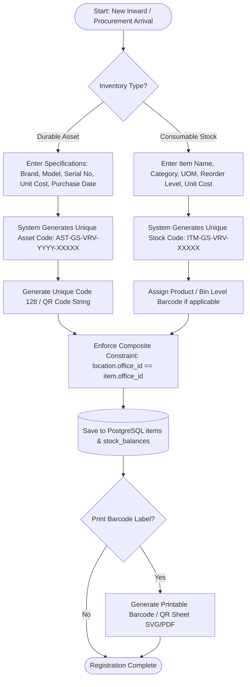
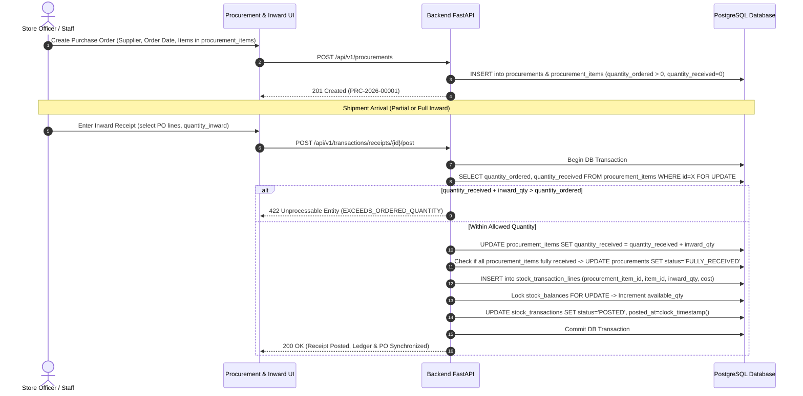
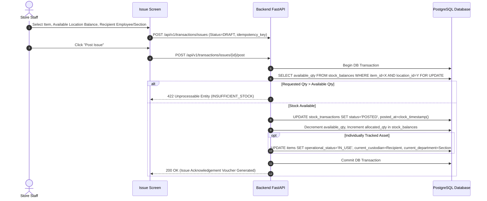
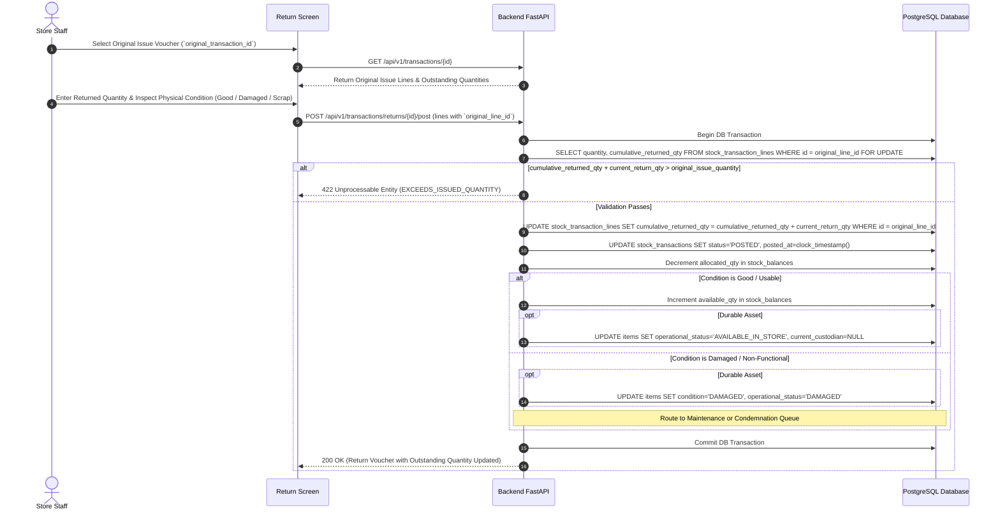

# Business Workflows & Process Specifications
## PS000214 – Dead Stock Inventory Management System
**Organization:** District Development Office – Gir Somnath, Veraval  
**Target User Group:** Officers and Staff of Store Department, District Panchayat, Gir Somnath  

This document details the complete operational workflows for PS000214, incorporating strict data-integrity rules, inventory movement ledger semantics, and configurable governance.

---

## 1. Asset & Inventory Registration Workflow


---

## 2. Procurement & Inward Receipt Workflow


---

## 3. Stock Movement Ledger: Outward Issue, Return & Reversal

### 3.1 Outward Issue Workflow


### 3.2 Linked Stock Return (Partial & Multiple Return Protection)


### 3.3 Reversal & Correction Voucher Workflow
*Note: Posted transactions are immutable and cannot be edited or deleted.*
1. An authorized user with `stock:reversal_create` permission invokes `POST /api/v1/transactions/{id}/reversal` with a mandatory `reversal_reason`.
2. System creates a new transaction with `transaction_type = 'REVERSAL_CORRECTION'` and links `original_transaction_id`.
3. Inverse line items are generated to safely offset balances in `stock_balances`.
4. Audit log records the exact before/after state with user identification.

---

## 4. Supplier Return / RMA (Vendor Return) Workflow
*Note: Strictly distinct from internal employee store returns.*

```mermaid
flowchart TD
    DetectDefect[Defect on Arrival / Warranty Failure / Wrong Specs Identified] --> CreateRMA[POST /api/v1/supplier-returns: Status=INITIATED]
    CreateRMA --> LinkRecords[Link to Supplier, Procurement PO, Warranty Card & Item ID]
    
    LinkRecords --> DispatchVendor[Physical Item Dispatched to Vendor: POST /api/v1/supplier-returns/{id}/dispatch]
    DispatchVendor --> UpdateStatusDispatched[Status: DISPATCHED_TO_VENDOR]
    UpdateStatusDispatched --> AdjustCustody[Durable Asset: Custody set to Vendor<br/>Consumables: Ledger posts SUPPLIER_RMA_OUT, moves available_qty to in_vendor_rma_qty]
    
    AdjustCustody --> VendorAssessment[Vendor Assesses Item: POST /api/v1/supplier-returns/{id}/vendor-response]
    VendorAssessment --> StatusAssessing{Vendor Decision?}
    
    StatusAssessing -- Rejection --> VendorRejects[Status: REJECTED_BY_VENDOR<br/>Item Returned to Store: Ledger reverses in_vendor_rma_qty -> available_qty]
    
    StatusAssessing -- Accept Replacement --> AcceptRep[POST /api/v1/supplier-returns/{id}/resolve: REPLACEMENT]
    AcceptRep --> InwardNewAsset[New Replacement Asset Registered with OEM Serial/Barcode<br/>Ledger posts SUPPLIER_RMA_IN<br/>Status: COMPLETED_CLOSED]
    
    StatusAssessing -- Accept Repair --> AcceptRepaired[POST /api/v1/supplier-returns/{id}/resolve: REPAIRED_RETURN]
    AcceptRepaired --> RestoreRepaired[Repaired Asset Restored to Store<br/>Ledger reverses in_vendor_rma_qty -> available_qty<br/>Status: COMPLETED_CLOSED]
    
    StatusAssessing -- Accept Credit / Refund --> AcceptCredit[POST /api/v1/supplier-returns/{id}/resolve: CREDIT_NOTE / REFUND]
    AcceptCredit --> DerecognizeBalance[Ledger posts SUPPLIER_RMA_WRITEOFF<br/>in_vendor_rma_qty decremented to 0<br/>Status: COMPLETED_CLOSED]
```

---

## 5. Classification Engine & Dead-Stock Review

### 5.1 Precedence & Calculation Rules
The automated Classification Engine runs on demand or via background schedule, evaluating inventory records against category-specific rules in the following strict order of precedence:

1. **Precedence 1 (Physical Condition):**
   - If `items.condition IN ('DAMAGED', 'SCRAP')` AND repair is uneconomical -> Classified as **`OBSOLETE`**.
2. **Precedence 2 (Age & Obsolescence Lifespan):**
   - If `item_age_years >= categories.obsolescence_years` (e.g. 5 years for IT equipment) AND `days_inactive >= categories.slow_moving_threshold_days` (e.g. 90 days) -> Classified as **`OBSOLETE`**.
3. **Precedence 3 (Non-Moving Inactivity Threshold):**
   - If `days_since_last_movement >= categories.inactivity_threshold_days` (e.g. 180 days) -> Classified as **`NON_MOVING`**.
4. **Precedence 4 (Slow-Moving Sluggishness Threshold):**
   - If `days_since_last_movement >= categories.slow_moving_threshold_days` (e.g. 90 days) -> Classified as **`SLOW_MOVING`**.
5. **Precedence 5 (Default):**
   - Otherwise -> Classified as **`ACTIVE`**.

### 5.2 Manual Override & Scheduled Job Protection
```mermaid
flowchart TD
    JobStart[Scheduled Classification Run: POST /api/v1/classifications/run] --> EvalItem[Evaluate Item against Precedence Rules]
    EvalItem --> CalcResult[Determine Calculated Classification]
    CalcResult --> CheckOverride{Is item currently overridden?<br/>(is_overridden == TRUE)}
    
    CheckOverride -- Yes --> PreserveOverride[UPDATE calculated_classification = CalcResult<br/>UPDATE contributing_factors = Details<br/>DO NOT TOUCH effective_classification]
    CheckOverride -- No --> ApplySystemClass[UPDATE calculated_classification = CalcResult<br/>UPDATE effective_classification = CalcResult<br/>UPDATE contributing_factors = Details]
    
    PreserveOverride --> AuditLog[Log Engine Evaluation to audit_logs]
    ApplySystemClass --> AuditLog
    
    AuditLog --> OfficerPanel[Store Officer Dead Stock Register View]
    OfficerPanel --> OverrideAction{Officer Action?}
    OverrideAction -- Manual Override --> RecordOverride[POST /api/v1/classifications/{item_id}/override<br/>Set is_overridden=TRUE, effective_classification=New, reason=Mandatory]
    OverrideAction -- Release Override --> ReleaseOverride[POST /api/v1/classifications/{item_id}/release-override<br/>Set is_overridden=FALSE, effective_classification=calculated_classification]
```

---

## 6. Physical Stock Verification & Discrepancy Reconciliation

```mermaid
flowchart TD
    StartSession[Store Officer Initiates Session: POST /api/v1/verifications/sessions] --> Snapshot[System Freezes Expected Inventory Snapshot into verification_items]
    Snapshot --> AuditorScan[Auditors Scan Barcodes in Store Rooms using Mobile/Desktop Camera or Scanner]
    
    AuditorScan --> ScanAPI[POST /api/v1/verifications/sessions/{id}/scan]
    ScanAPI --> CheckDuplicate{Has this item barcode already been scanned in this session?}
    
    CheckDuplicate -- Yes --> LogDuplicate[INSERT into verification_scan_events: is_duplicate_scan=TRUE, scan_result=DUPLICATE_SCAN_REPEATED<br/>Return Alert: Repeated Scan Detected]
    CheckDuplicate -- No --> MatchSnapshot{Barcode matches item in session baseline?}
    
    MatchSnapshot -- No / Unknown --> LogUnexpected[INSERT into verification_scan_events: scan_result=UNEXPECTED_ITEM / UNKNOWN_BARCODE<br/>INSERT into verification_items: discrepancy_type=UNEXPECTED_ITEM]
    MatchSnapshot -- Yes --> CompareAttributes{Observed Location & Condition match Snapshot?}
    
    CompareAttributes -- Exact Match --> LogVerified[INSERT into verification_scan_events: scan_result=MATCHED_VERIFIED<br/>UPDATE verification_items: counted_qty=expected_qty, discrepancy_type=NONE]
    CompareAttributes -- Mismatch --> LogMismatch[INSERT into verification_scan_events: scan_result=LOCATION_MISMATCH / CONDITION_MISMATCH<br/>UPDATE verification_items: discrepancy_type=LOCATION_MISMATCH / CONDITION_MISMATCH]
    
    LogVerified --> ActiveAuditWorkspace[Active Session Workspace: GET /api/v1/verifications/sessions/{id}]
    LogDuplicate --> ActiveAuditWorkspace
    LogUnexpected --> ActiveAuditWorkspace
    LogMismatch --> ActiveAuditWorkspace
    
    ActiveAuditWorkspace --> ReviewUnscanned{Session Review: Any snapshot items unscanned?}
    ReviewUnscanned -- Yes --> MarkNotFound[Flag remaining unscanned items: discrepancy_type=NOT_FOUND]
    
    MarkNotFound --> OfficerReconcile[POST /api/v1/verifications/sessions/{id}/reconcile<br/>Store Officer records resolutions for all discrepancies with evidence]
    OfficerReconcile --> ConcludeSession[POST /api/v1/verifications/sessions/{id}/complete<br/>Audit Completed: Generates Official Reconciliation Report]
```

---

## 7. Condemnation Proposal to Regulated Disposal Workflow
```mermaid
flowchart TD
    DeadStock[Non-Moving / Obsolete / Damaged Asset] --> Proposal[Store Staff/Officer Creates Condemnation Proposal]
    Proposal --> AttachDocs[Upload Physical Inspection Report & Condition Photos]
    AttachDocs --> Submit[POST /api/v1/condemnations: Status=SUBMITTED]
    Submit --> UpdatePending[(Update Item Status: PENDING_CONDEMNATION)]
    
    UpdatePending --> OfficerReview[Store Officer Evaluates Condition & Scrap Value]
    OfficerReview --> PostReview[POST /api/v1/condemnations/{id}/review: Status=UNDER_REVIEW]
    
    PostReview --> DynamicApprover{Configurable Approval Authority<br/>(Resolved from system_settings)}
    
    DynamicApprover -- Request Info --> ReturnToStaff[Status: MORE_INFO_REQUIRED -> Return to Staff]
    DynamicApprover -- Reject --> CancelProposal[POST /api/v1/condemnations/{id}/decision: REJECTED<br/>Item Restored to Active Inventory]
    DynamicApprover -- Approve --> OrderIssued[POST /api/v1/condemnations/{id}/decision: APPROVED<br/>Capture Official Sanction Order Number & Date]
    
    OrderIssued --> UpdateApproved[(Update Item Status: PENDING_DISPOSAL)]
    UpdateApproved --> SelectDisposal[Select Regulated Disposal Method:<br/>Public Auction / Scrap Sale / E-Waste Recycling / Destruction]
    
    SelectDisposal --> ExecuteDisposal[Execute Disposal: POST /api/v1/disposals<br/>Record Sale Proceeds, Buyer Details, Upload Certificate]
    ExecuteDisposal --> WriteOff[(Post DISPOSAL_WRITEOFF to Movement Ledger)]
    WriteOff --> Derecognize[(Update Item Status: DISPOSED, Lock from Future Moves)]
    Derecognize --> ArchiveRegister[Official Disposal Register Updated]
```
